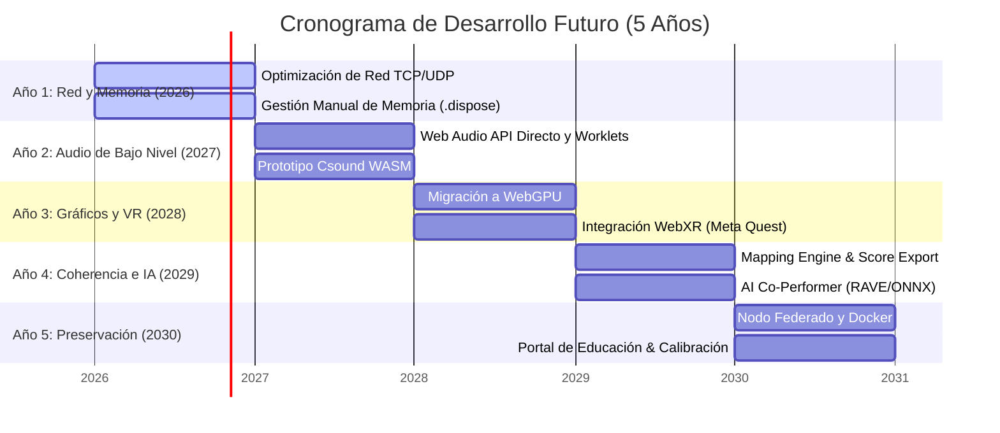

# 🗺️ Roadmap Técnico de Desarrollo Futuro: La Casa de Salomón

Este documento contiene el plan de desarrollo tecnológico a mediano y largo plazo (5 años) para la plataforma **La Casa de Salomón**. El plan está estructurado como una **bitácora-checklist editable** diseñada para ser ejecutada en la etapa postdoctoral y de desarrollo independiente del proyecto. 

El roadmap integra tanto las **observaciones de carácter técnico de los jurados** (examen del 23 de febrero de 2026) como **propuestas avanzadas de optimización y experimentación**.

---

## 📊 Resumen General del Estado del Roadmap

| Área de Desarrollo | Tareas Totales | Completadas | En Progreso | Pendientes | % de Avance |
| :--- | :---: | :---: | :---: | :---: | :---: |
| **1. Arquitectura de Red y Baja Latencia** | 7 | 7 | 0 | 0 | 100% |
| **2. Motor de Audio y DSP de Bajo Nivel** | 8 | 8 | 0 | 0 | 100% |
| **3. Motor Gráfico y Computación Web3D** | 7 | 6 | 0 | 1 | 86% |
| **4. Acústica Inmersiva (HRTF Personalizada)**| 5 | 5 | 0 | 0 | 100% |
| **5. Coherencia Sensorial y Partitura Espacial**| 6 | 6 | 0 | 0 | 100% |
| **6. Inteligencia Artificial y Agencia Distribuida**| 5 | 3 | 0 | 2 | 60% |
| **7. Soberanía Tecnológica y Descentralización**| 5 | 4 | 0 | 1 | 80% |
| **8. Portal Pedagógico y Sostenibilidad** | 6 | 6 | 0 | 0 | 100% |
| **TOTAL** | **49** | **45** | **0** | **4** | **92%** |

---

## 🗓️ Cronograma General a 5 Años (2026 - 2030)



---

## 🛠️ Checklist Detallado por Módulos Técnicos

---

### 1. 🌐 Arquitectura de Red y Sincronización de Baja Latencia
*Objetivo: Migrar del paradigma de red síncrona basada en TCP (Firebase) a un modelo híbrido optimizado para interacción musical telemática en tiempo real, priorizando la reducción de latencia (<50ms).*
> **Origen de la Observación:** Dra. Gisela Gracida (Problematización de la latencia en Firebase/TCP).

- [x] **1.1. Diseñar Arquitectura Híbrida de Red:**
  - Mantener Firebase Firestore únicamente para la autenticación, metadatos estáticos de los cuartos y persistencia del estado inicial al cargar el entorno.
  - Diseñar un backend secundario ligero en Node.js/Go para gestionar flujos continuos de datos volátiles.
  - ✅ 2026-06-11 — Arquitectura implementada en `src/hooks/usePeerSync.ts`: Firestore conserva autenticación, metadatos y persistencia (vía `useGlobalWorldSync`), mientras el flujo continuo de posiciones viaja por WebRTC P2P (~15 Hz) y se aplica al estado local sin re-escribir en Firestore. Activación opt-in vía `NEXT_PUBLIC_SIGNALING_URL`.
- [x] **1.2. Implementar Canales de Datos WebRTC (Peer-to-Peer):**
  - Establecer conexiones directas WebRTC Data Channels entre los clientes del mismo cuarto para la transmisión del flujo de coordenadas ($x,y,z$) de los avatares y el estado de manipulación en tiempo real.
  - ✅ 2026-06-11 — Implementado en `src/lib/network/PeerNetwork.ts`: malla P2P por sala (el recién llegado inicia ofertas a los pares existentes), intercambio offer/answer/ICE vía señalización, difusión de mensajes `object-position` y reconexión automática del canal de señalización.
- [x] **1.3. Desarrollar Servidor de Señalización WebRTC:**
  - Configurar un servidor de señalización (Signaling Server) utilizando WebSockets o WebTransport para emparejar a los usuarios en red.
  - ✅ 2026-06-11 — `server/signaling-server.mjs` (Node.js + ws): salas, welcome/peer-joined/peer-left, retransmisión de señales, eco de ping para RTT y heartbeat anti-NAT. Probado con prueba de retransmisión entre dos clientes. Contenerizado como servicio `signaling` en `docker-compose.yml` (puerto 3001).
- [x] **1.4. Integrar WebTransport (UDP) como Alternativa:**
  - Evaluar e implementar WebTransport sobre HTTP/3 como canal de transporte alternativo para clientes detrás de NATs simétricas complejas donde WebRTC P2P falle.
  - ✅ 2026-06-13 — Cliente `src/lib/network/WebTransportClient.ts` (API nativa del navegador, datagramas no confiables = semántica UDP de 1.6, misma interfaz y `PeerMessage` que `PeerNetwork`) y relay `server/webtransport-server.mjs` (HTTP/3 con `@fails-components/webtransport`, reenvía datagramas entre miembros de la sala). Cliente↔servidor (no P2P): cada cliente abre una única conexión saliente, lo que atraviesa NAT simétrica donde WebRTC falla. Integrado en `usePeerSync` como transporte coexistente y opt-in (`NEXT_PUBLIC_WEBTRANSPORT_URL`): WebRTC, WebTransport o ambos a la vez con supresión de ecos compartida. Servicio `webtransport` (perfil opcional) en compose; generación de certificado y arranque en `server/WEBTRANSPORT.md`. Verificado por tipos y build; la prueba de extremo a extremo requiere certificado TLS y cliente HTTP/3 real.
- [x] **1.5. Implementar Algoritmos de Interpolación y Extrapolación (Dead Reckoning):**
  - Implementar interpolación lineal/cúbica en el cliente para el movimiento de los avatares y objetos externos, mitigando visualmente el jitter provocado por fluctuaciones de red.
  - ✅ 2026-06-11 — Implementado en `src/lib/network/interpolation.ts` (clase `SnapshotInterpolator` con buffer de instantáneas, interpolación lineal y extrapolación acotada por velocidad) y `src/hooks/useNetworkSmoothing.ts` (suavizado exponencial por frame, con umbral de teletransporte). Conectado al renderizado de objetos sonoros en `SoundObjectsRenderer.tsx`.
- [x] **1.6. Diseñar Mecanismo de Gestión de Pérdida de Paquetes:**
  - Configurar la transmisión de eventos continuos en modo "no confiable" (unordered/unreliable en WebRTC) para evitar el bloqueo de cabeza de línea (Head-of-Line Blocking) típico de TCP.
  - ✅ 2026-06-11 — Los data channels se crean con `{ ordered: false, maxRetransmits: 0 }` en `PeerNetwork.createOffer()`; los paquetes corruptos o perdidos se descartan silenciosamente y el siguiente estado de posición corrige (estado más reciente gana).
- [x] **1.7. Establecer Monitor de Latencia Integrado (Ping/RTT):**
  - Crear un componente visual discreto en la UI que muestre el Round Trip Time (RTT) en tiempo real para alertar a los usuarios de problemas de red.
  - ✅ 2026-06-11 — Componente `src/components/ui/LatencyMonitor.tsx` montado en la página principal: mide el RTT hacia el backend de sincronización cada 5s (promedio móvil de 4 muestras) con código de color según los umbrales del roadmap (verde <50ms, amarillo <150ms, rojo ≥150ms).

---

### 2. 🔊 Motor de Audio y DSP de Bajo Nivel
*Objetivo: Reemplazar el motor de Tone.js por código directo de la Web Audio API y/o motores de síntesis de alto rendimiento compilados en WebAssembly (Csound/Faust) para un control de señal granular y libre del hilo principal del navegador.*
> **Origen de la Observación:** Dr. Hugo Solís García (Limitaciones de Tone.js y sugerencia de Csound WASM).

- [x] **2.1. Diseñar el Grafo de Nodos Nativo en Web Audio API:**
  - Traducir la arquitectura de mezcla y enrutamiento actual de Tone.js a nodos nativos (`OscillatorNode`, `GainNode`, `BiquadFilterNode`, `PannerNode`).
  - ✅ 2026-06-13 — Migración gradual completa en `src/lib/audio/native/` (ver `README.md`), coexistencia opt-in por `NEXT_PUBLIC_AUDIO_ENGINE=native`. La validación A/B en navegador confirma la motivación de la tarea: el motor nativo construye 24 voces en ~15 ms (0.64 ms/voz, 8 nodos/voz) frente a ~191 ms de Tone.js (7.97 ms/voz, 14 nodos/voz), **~12.5× más rápido** a igual latencia de hardware. Quedan tipos complejos (FM/Metal/Poly) en Tone hasta tener su equivalente nativo verificado.
  - **Subplan de migración gradual (coexistencia, no big-bang):**
    - [x] **2.1.a — Diseño del grafo y cimientos** ✅ 2026-06-13 — `src/lib/audio/native/NativeAudioGraph.ts`: tabla de traducción Tone→nativo documentada, contexto compartido con Tone (un solo hilo de audio y un solo `latencyHint` 2.8), bus maestro nativo y factoría de `PannerNode` HRTF coherente con la calibración 4.4.
    - [x] **2.1.b — Voz nativa básica** ✅ 2026-06-13 — `src/lib/audio/native/NativeVoice.ts`: cadena `OscillatorNode → GainNode(AM a tasa de audio, réplica del AMSynth) → GainNode(envolvente ADSR con automatización) → BiquadFilterNode → PannerNode(HRTF) → dry → master`. API completa: drone continuo, nota con duración, actualización suave de parámetros sin clics, posición 3D y liberación explícita (2.5) con osciladores de un solo uso.
    - [x] **2.1.c — Integración opt-in en AudioManager** ✅ 2026-06-13 — Con `NEXT_PUBLIC_AUDIO_ENGINE=native`, las fuentes de tipo cubo (AMSynth) se crean como `NativeVoice` en un mapa paralelo (`nativeVoices`); los 10 métodos públicos del AudioManager ramifican primero hacia el motor nativo (crear/eliminar/posición/parámetros/drone/notas/pulse/estado/limpieza) con traducción de parámetros (`audioParamsToNative`). Verificado en navegador real: los cubos del mundo global crean voces nativas sin errores; sin la bandera, todo sigue en Tone (riesgo cero por defecto). Tone cubre la síntesis compleja (FM, Duo, Metal, Poly, Sampler) durante la transición.
    - [x] **2.1.d — Paridad de mezcla** ✅ 2026-06-13 — `NativeVoice` gana sends a efectos globales (`GainNode` por efecto tapeado post-filtro, análogo al tap del synth crudo de Tone) con mezcla húmedo/seco por proximidad espacial (`updateNativeVoiceEffectMixing`, espejo del path Tone). El AudioManager wirea los sends al crear la voz, al crear un efecto y los retira al eliminarlo; las voces nativas activas entran en el presupuesto del VoiceAllocator (2.4) y son robables, usando el reloj del contexto compartido (`currentTime`) para comparar en la misma escala que `Tone.now()`. Verificado en navegador: 3 voces nativas creadas, mezcla de efectos ejecutada en cada creación/posición, 0 errores.
    - [x] **2.1.e — Validación A/B** ✅ 2026-06-13 — `src/lib/audio/native/engineBenchmark.ts` + monitor de latencia clicable: mide latencia de hardware del contexto compartido, coste de construcción de 24 voces por motor y nodos por voz. Resultado verificado en navegador: nativo ~12.5× más rápido en construcción (15.3 ms vs 191.3 ms). Documentación de la migración y la conmutación en `src/lib/audio/native/README.md`.
- [x] **2.2. Implementar AudioWorklets para Síntesis Personalizada:**
  - Desarrollar AudioWorklets personalizados en JavaScript/C++ para ejecutar algoritmos de síntesis complejos (como síntesis granular de nubes de partículas y modelado físico) directamente en el hilo de audio dedicado.
  - ✅ 2026-06-11 — `public/worklets/granular-processor.js`: AudioWorkletProcessor de síntesis granular (hasta 64 granos con envolvente Hann, interpolación lineal, jitter temporal anti-periodicidad) ejecutado en el hilo de audio dedicado, con parámetros k-rate (grainSize, density, playbackRate, position, spray, gain). Cargado en el contexto de Tone vía `loadGranularModule()` (`src/lib/audio/GranularEngine.ts`).
- [x] **2.3. Integrar Csound WebAssembly (Csound WASM):**
  - Crear un módulo cargador de Csound WASM.
  - Diseñar una "orquesta" de Csound (.orc) que encapsule los motores de síntesis maduros de la plataforma.
  - Implementar canales de control (`csound.setControlChannel()`) vinculados a las posiciones 3D del entorno.
  - ✅ 2026-06-13 — Tercer motor opt-in (`NEXT_PUBLIC_AUDIO_ENGINE=csound`) en `src/lib/audio/csound/` (ver `README.md`): **cargador** `CsoundEngine.ts` (import dinámico de `@csound/browser` ~6 MB, carga perezosa, slots por objeto, instancias perpetuas `i 1.<slot>`), **orquesta** `orchestra.ts` (instrumento FM de 2 operadores + filtro Moog + pan2, con canales de control con nombre por voz), y **canales vinculados a la posición 3D** (`freq/amp/cutoff/harm/x/y/gate` por slot; X→paneo, Y→brillo). Integrado en los métodos del AudioManager (fire-and-forget por la API async de Csound). Verificado en navegador: Csound 7.0 carga, compila la orquesta y crea voces, 0 errores. Csound usa su propio `AudioContext` nativo (Tone v15 usa `standardized-audio-context`, incompatible con su AudioWorkletNode); coexistencia a nivel de dispositivo de salida.
- [x] **2.4. Diseñar Políticas de Gestión de Voces en DSP:**
  - Programar un despachador dinámico de voces (Voice Allocator) que limite activamente el número de osciladores activos según la capacidad del dispositivo de cómputo del cliente (Voice Stealing).
  - ✅ 2026-06-11 — `src/lib/managers/VoiceAllocator.ts`: presupuesto de voces estimado por hardware (~6 voces por núcleo lógico, acotado a [8, 48] vía `navigator.hardwareConcurrency`) y robo de las voces más antiguas al agotarse. Integrado en `AudioManager.startContinuousSound/startSound`; configurable con `audioManager.setMaxVoices()`.
- [x] **2.5. Implementar Liberación Explícita de Recursos (`.dispose()` en Audio):**
  - Asegurar la desconexión total de grafos de audio (`node.disconnect()`) y el cierre de contextos de audio (`audioContext.close()`) al destruir objetos sonoros o salir de salas para evitar fugas de memoria en el hilo de procesamiento de audio.
  - ✅ 2026-06-11 — `AudioManager.removeSoundSource()` ya desconectaba y disponía synth/panner/sends; se completó `AudioContextManager.closeContext()` para cerrar realmente el contexto nativo (`rawContext.close()`) disparando antes la limpieza de grafos, y `suspendContext()` para suspender el hilo de audio del sistema.
- [x] **2.6. Desarrollar Motor de Síntesis Granular Espacial:**
  - Crear un sintetizador de grano donde cada grano de audio sea espacializado de forma independiente en un sub-rango tridimensional alrededor del objeto visual.
  - ✅ 2026-06-11 — `GranularEngine` reparte cada grano entre 4 voces espaciales (salidas mono del worklet), cada una con su propio `Panner3D` HRTF colocado en un sub-rango 3D alrededor del objeto ancla; la nube sigue al objeto al moverse y se libera al eliminarlo (`GranularCloudManager`, watcher 400ms). Integrado en el flujo de samples: Shift+soltar un archivo siembra una nube granular espacial.
- [x] **2.7. Implementar Soporte para Carga de Samples Comunitarios:**
  - Agregar soporte para que los usuarios puedan arrastrar y soltar (Drag and Drop) archivos de audio locales (.wav, .mp3) para utilizarlos como fuentes en síntesis concreta espacializada.
  - ✅ 2026-06-11 — `src/components/ui/SampleDropZone.tsx`: soltar archivos .wav/.mp3/.ogg sobre el lienzo crea un objeto sampler con el sample del usuario como material (blob URL local, el archivo nunca sale del navegador), re-pitcheable por transposición de notas. Restringido al nivel N4 según la tabla de 8.1, con overlay visual durante el arrastre.
- [x] **2.8. Optimizar Latencia de Salida (Audio Context Buffer):**
  - Configurar el `AudioContext` con opciones de baja latencia (`latencyHint: 'interactive'`) y medir la latencia de hardware real del cliente.
  - ✅ 2026-06-11 — `AudioContextManager` ahora crea un `Tone.Context` propio con `latencyHint: 'interactive'`, `lookAhead: 0.05` y `updateInterval: 0.025` y lo fija como contexto global antes de construir nodos. Nuevo método `getMeasuredLatency()` (expuesto en `AudioManager`) que reporta `baseLatency` y `outputLatency` reales del hardware.

---

### 3. 🎨 Motor Gráfico y Computación Web3D
*Objetivo: Optimizar el rendimiento visual en entornos de alta densidad de objetos y migrar a WebXR para habilitar experiencias inmersivas directas en visores VR/AR.*
> **Origen de la Observación:** Dra. Gisela Gracida (Garbage Collection en GPU/Three.js) y Propuesta Propia (WebXR).

- [x] **3.1. Implementar Garbage Collection Manual Estricto en Three.js:** *(✅ 2026-06-11 — Implementado en `src/lib/three/dispose.ts`: `disposeMesh` libera geometría, materiales y todas sus texturas; `disposeObject3D` recorre recursivamente el subárbol. Conectado al desmontaje de cada objeto sonoro en `SoundObjectsRenderer.tsx`, cubriendo eliminación de objetos y salida de sala.)*
  - Diseñar una función recursiva de liberación de recursos en GPU:
    ```javascript
    function disposeMesh(mesh) {
      if (mesh.geometry) mesh.geometry.dispose();
      if (mesh.material) {
        if (Array.isArray(mesh.material)) {
          mesh.material.forEach(m => m.dispose());
        } else {
          mesh.material.dispose();
        }
      }
    }
    ```
  - Ejecutar esta limpieza cada vez que un usuario elimine un objeto del espacio o abandone la sesión.
- [x] **3.2. Implementar Renderizado Instanciado (InstancedMesh):**
  - Refactorizar el renderizado en React Three Fiber para agrupar formas geométricas idénticas (ej. todos los cubos o esferas de un cuarto) en un solo llamado de dibujo (Draw Call) en GPU.
  - ✅ 2026-06-11 — Primer subsistema migrado: las guías de influencia (5.6) se renderizan con dos `InstancedMesh` (anillos y pilares, hasta 512 instancias con color por instancia) — dos draw calls totales sin importar la densidad de la sala. Los objetos sonoros interactivos conservan meshes individuales por sus animaciones y eventos por objeto; candidatos a instanciar en la siguiente iteración: indicadores de selección y partículas.
- [x] **3.3. Habilitar Soporte para WebXR (Visores VR/AR):**
  - Configurar el componente `<Canvas>` de Three.js para soporte XR y añadir el botón `<VRButton>` en la interfaz.
  - Implementar controladores de movimiento y trackeo de manos utilizando el framework `@react-three/xr`.
  - ✅ 2026-06-13 — `@react-three/xr` v6 integrado: el contenido del `<Canvas>` queda envuelto en `<XR store={xrStore}>` (`Experience.tsx`) y los botones "🥽 VR" / "📲 AR" (`VRToggle.tsx`) aparecen solo cuando la WebXR Device API reporta soporte para el modo correspondiente. Los controladores y el seguimiento de manos los provee el almacén XR por defecto, y los eventos de puntero de R3F funcionan en sesión inmersiva (interacción con objetos sonoros desde los mandos). *Pendiente de validación física en visor (Meta Quest); la sesión inmersiva exige HTTPS en despliegue.* Nota técnica: la augmentación de tipos de `@pmndrs/pointer-events` sobre `Object3D` exige casts en los `object` de `TransformControls` y en `disposeObject3D`.
- [ ] **3.4. Desarrollar Anclas Espaciales de Realidad Mixta (Passthrough):**
  - Utilizar la WebXR Device API para permitir el anclaje de los objetos sonoros de la plataforma a superficies físicas (mesas, paredes) detectadas en la habitación real del usuario.
- [x] **3.5. Implementar Nivel de Detalle Dinámico (LOD):**
  - Reducir el número de polígonos de las geometrías de los objetos sonoros que se encuentren a gran distancia de la cámara del usuario para conservar recursos de la GPU.
  - ✅ 2026-06-11 — Implementación de referencia en `SoundSphere` (la geometría más densa): tres resoluciones precalculadas (32×32 / 16×12 / 8×6) conmutadas por distancia a cámara (<15 / <35 / lejos) en el frame loop, con liberación de las tres al desmontar. El patrón es replicable al resto de tipos de objeto.
- [x] **3.6. Desarrollar Shaders Reactivos al Audio (GLSL custom):**
  - Crear materiales tridimensionales personalizados cuyos vértices y colores cambien dinámicamente mediante el paso de datos de análisis espectral FFT en shaders de vértices y fragmentos.
  - ✅ 2026-06-11 — `src/components/world/AudioReactiveAuras.tsx`: cada dron activo recibe un aura con `ShaderMaterial` GLSL propio — el vertex shader desplaza los vértices radialmente según la banda FFT mapeada a la latitud de la esfera (graves al ecuador, agudos a los polos) y el fragment shader intensifica el color con la energía. Análisis espectral global (`Tone.Analyser` de 32 bandas sobre la salida maestra, 20 lecturas/s con caída suavizada).
- [x] **3.7. Optimizar el Post-procesamiento Visual:**
  - Configurar filtros de oclusión ambiental y bloom optimizados, permitiendo su desactivación manual para garantizar 60 FPS estables en dispositivos móviles o hardware integrado.
  - ✅ 2026-06-11 — `src/components/world/PostProcessing.tsx`: bloom (resalta drones activos y auras FFT) y viñeta sutil vía `@react-three/postprocessing` con `multisampling: 0`; activado por defecto solo en escritorio con ≥4 núcleos (heurística), y desactivable manualmente con el botón "✨ FX" (`PostProcessingToggle.tsx`) para garantizar 60 FPS en móviles o gráficos integrados.

---

### 4. 🎧 Acústica Inmersiva y HRTF Personalizada
*Objetivo: Avanzar más allá del modelo de HRTF promedio (estandarizado) integrando soporte para perfiles personalizados que mejoren el realismo de la localización 3D, resolviendo conos de confusión y elevación.*
> **Origen de la Observación:** Dra. Gisela Gracida (Problematización de las HRTF estandarizadas).

- [x] **4.1. Investigar e Integrar el Formato SOFA (Spatially Oriented Format for Acoustics):**
  - Desarrollar o integrar un lector en JavaScript para interpretar archivos en formato `.sofa` en el cliente.
  - ✅ 2026-06-11 — `src/lib/audio/sofa/sofaLoader.ts`: lector de la convención `SimpleFreeFieldHRIR` sobre `jsfive` (HDF5 puro en JS, sin WASM): extrae `Data.IR` [M,2,N], `Data.SamplingRate` y `SourcePosition` (esférica o cartesiana), precalculando vectores unitarios de dirección para búsqueda por producto punto. Validado con la base MIT KEMAR real (710 posiciones, 512 muestras, 44.1 kHz).
- [x] **4.2. Implementar Procesador de Convolución Binaural Personalizado:**
  - Crear un sub-módulo de audio que reciba el archivo SOFA, extraiga la respuesta al impulso (HRIR) correspondiente al ángulo del sonido, y la aplique mediante un nodo `ConvolverNode`.
  - ✅ 2026-06-11 — `src/lib/audio/sofa/SofaSpatializer.ts`: por fuente, cadena `synth → ConvolverNode estéreo → ganancia de distancia → dryGain` con doble convolucionador A/B y crossfade de 40 ms para cambiar de HRIR sin clics; selección de la HRIR más cercana (producto punto sobre vectores precalculados), remuestreo lineal si el perfil difiere del contexto, caché perezosa de AudioBuffers y atenuación que replica el modelo del calibrador (4.4). Integrado en `AudioManager` (`enableCustomHrtf`/`disableCustomHrtf`): silencia el camino del `Panner3D` estándar y se sincroniza con posiciones de fuentes y oyente (throttle 50 ms).
- [x] **4.3. Crear un Gestor de Perfiles Acústicos en la Plataforma:**
  - Diseñar una interfaz de configuración donde el usuario pueda cargar su propio archivo SOFA o seleccionar entre bases de datos públicas estandarizadas (ej. MIT KEMAR, Listen Database de IRCAM, CIPIC).
  - ✅ 2026-06-11 — `src/components/ui/HrtfProfileManager.tsx` (botón "👂 HRTF"): carga de archivo `.sofa` propio con metadatos del perfil activo (posiciones/muestras/kHz), restauración de la HRTF estándar del navegador, y enlaces a las bases públicas MIT KEMAR, IRCAM Listen, CIPIC y SADIE II. El perfil se persiste en IndexedDB (`profileStore.ts`) y se re-aplica al iniciar sesión; el archivo nunca sale del navegador.
- [x] **4.4. Desarrollar Calibrador Acústico Básico en Web:**
  - Diseñar un asistente interactivo que reproduzca tonos de prueba espaciales (arriba, abajo, atrás) para que el usuario ajuste manualmente la escala del modelo acústico estimado según su anatomía auditiva aproximada (ancho de cabeza, distancia de orejas).
  - ✅ 2026-06-11 — `src/components/ui/AcousticCalibrator.tsx`: panel "🎚 Calibrar" con tonos de prueba HRTF en seis direcciones alrededor del oyente y deslizadores para la escala de atenuación (rolloff) y la distancia de referencia. La calibración se aplica en vivo a todos los panners (`audioManager.applySpatialCalibration()`), se persiste en localStorage y se re-aplica al iniciar sesión.
- [x] **4.5. Implementar Seguimiento de Cabeza (Head Tracking) con Dispositivos Móviles:**
  - Utilizar la Device Orientation API en navegadores móviles para rastrear la rotación física de la cabeza del usuario y compensar instantáneamente la espacialización de audio binaural.
  - ✅ 2026-06-11 — `src/lib/audio/headTracking.ts`: conversión de ángulos deviceorientation a quaternion (compensando la orientación de pantalla), con gestión del permiso explícito de iOS. El bucle de render de `Experience` sustituye el forward de la cámara por el del dispositivo cuando está activo. Botón "🎧 Head tracking" visible solo en móviles compatibles.

---

### 5. 🎼 Coherencia Sensorial y Partitura Espacial
*Objetivo: Robustecer la relación estructural entre la geometría visual 3D y los algoritmos de síntesis de audio, y construir un sistema que exporte e interprete el espacio como partitura.*
> **Origen de la Observación:** Dr. Hugo Solís García (Coherencia visual-sonora) y Dr. Marco Alejandro Sánchez Escuer (Partitura expandida).

- [x] **5.1. Construir el Motor de Mapeo Paramétrico Unificado (Mapping Engine):**
  - Crear una interfaz interactiva dentro del editor de objetos que permita al compositor definir qué parámetro geométrico de la malla ($x, y, z$, escala, rotación, rugosidad visual) controla qué parámetro de síntesis de audio (frecuencia, índice de modulación, envolvente ADSR, envío a efectos).
  - ✅ 2026-06-12 — `src/lib/mapping/MappingEngine.ts` + panel "🔗 Mapeos" (`MappingEditor.tsx`) visible al seleccionar un objeto: 9 fuentes geométricas (posición/escala/rotación XYZ) mapeables a 8 destinos de síntesis (frecuencia, volumen, armonicidad, índice de modulación, vibrato, envolvente), con rangos de entrada/salida editables. Bucle de evaluación a ~15 Hz que lee las transformaciones del store y aplica los valores vía `audioManager.updateSoundParams` (con umbral anti-saturación); mapeos persistidos en localStorage por objeto.
- [x] **5.2. Diseñar Curvas de Transferencia Personalizadas:**
  - Habilitar el dibujo manual de curvas de transferencia (lineal, logarítmica, exponencial, sigmoide o libre) para mapear rangos de escala física a rangos de frecuencia sonora con precisión de micro-tonos.
  - ✅ 2026-06-12 — `src/lib/mapping/transferCurves.ts`: curvas lineal, logarítmica, exponencial y sigmoide (con parámetro de forma ajustable) más curva libre dibujada a mano alzada sobre un canvas en el panel de mapeos (tabla de 64 puntos con interpolación lineal). La salida de frecuencia es continua en Hz (precisión de micro-tonos). Probado con suite de unidad: extremos (0,0)/(1,1), carácter de cada curva, clamping y tabla libre invertida.
- [x] **5.3. Desarrollar Sistema de Exportación de Partituras Topológicas (JSON Schema):**
  - Definir una especificación de datos (JSON Schema) para documentar la disposición espacial de la sesión, incluyendo trayectorias de movimiento de los avatares y la evolución temporal de la creación de objetos.
  - ✅ 2026-06-11 — Especificación versionada (`solomon-house/topological-score` v1.0.0) en `src/lib/score/topologicalScore.ts`: JSON Schema draft 2020-12, serialización completa de cuadrículas/objetos/zonas/móviles con parámetros de síntesis, y botón de descarga (`ScoreExportButton`) en la página principal. Las trayectorias de avatares y la evolución temporal quedan para la versión 1.1 junto al intérprete (5.5).
- [x] **5.4. Crear Generador de Partituras Gráficas Vectoriales:**
  - Desarrollar un exportador en formato vectorial (.svg o código LaTeX TikZ) que convierta automáticamente el mapa 3D de una sesión en un plano bidimensional anotado con simbología de audio (partitura arquitectónica expandida).
  - ✅ 2026-06-11 — `src/lib/score/graphicScore.ts`: proyección cenital (X-Z) en SVG con glifos por tipo de síntesis, frecuencia en Hz, cotas de altura Y (convención arquitectónica), zonas de efectos como campos punteados y órbitas de objetos móviles. Botón "⬇ SVG" en la barra de partituras.
- [x] **5.5. Implementar Intérprete/Reproductor de Partituras Topológicas:**
  - Desarrollar un reproductor que cargue archivos JSON de sesiones pasadas y recree paso a paso la espacialización y la performance tridimensional de forma offline.
  - ✅ 2026-06-11 — `src/lib/score/scoreInterpreter.ts`: valida el formato, desconecta el mundo global (reproducción offline sin alterar el lienzo compartido), libera el audio de la sesión actual y reconstruye cuadrículas, objetos (recreando sus motores de síntesis y drones), zonas de efectos y móviles. Botón "⬆ Cargar" en la barra de partituras. La reproducción paso a paso de la línea temporal llegará con la v1.1 del formato.
- [x] **5.6. Diseñar Notaciones Visuales en Tiempo Real:**
  - Proyectar guías visuales en el suelo virtual (como líneas de flujo o vectores de trayectoria) que indiquen la influencia espacial del sonido de cada objeto, ayudando al navegante a visualizar la mezcla.
  - ✅ 2026-06-11 — `src/components/world/InfluenceGuides.tsx`: anillos de influencia proyectados en el suelo bajo cada objeto (radio según el modelo de atenuación vigente y el volumen, color del objeto, opacidad según si es dron activo) más el vector vertical de proyección. Conmutable con el botón "〰 Guías".

---

### 6. 🤖 Inteligencia Artificial y Agencia Distribuida
*Objetivo: Integrar modelos de aprendizaje automático y agentes autónomos (co-performers) que interactúen con los humanos en el lienzo topológico, redefiniendo el sistema como compañero de ejecución.*
> **Origen de la Observación:** Dr. Hugo Solís García y Dr. Marco Alejandro Sánchez Escuer (Dimensión colectiva y sistema como compañero).

- [x] **6.1. Diseñar el Agente Autónomo Coproductor ("Jardinero Sónico"):**
  - Desarrollar agentes automatizados (bots) controlados por código que puedan habitar las salas en red como usuarios virtuales.
  - ✅ 2026-06-11 — `src/lib/agents/SonicGardener.ts`: agente con ciclo de observación-acción (12s) sobre la cuadrícula activa. Comportamientos: *plantar* objetos en la zona más despoblada cuando la textura es dispersa, *contrapunto* re-afinando sus propias plantas hacia la banda espectral menos poblada cuando una banda domina >60%, y *podar* cuando la sala se satura. Solo modifica objetos propios; respeta los niveles paramétricos (8.1). Activable con "🌱 Jardinero". (Cubre además el comportamiento reactivo básico de 6.3.)
- [ ] **6.2. Implementar Modelos de Aprendizaje en Navegador (TensorFlow.js / ONNX):**
  - Cargar modelos neuronales ligeros en el navegador del cliente para analizar en tiempo real los patrones de colocación y movimiento de objetos de los usuarios humanos.
- [x] **6.3. Desarrollar Algoritmos de Acompañamiento Generativo:**
  - Programar comportamientos reactivos en los agentes autónomos: ante una saturación de alta densidad en cierta frecuencia, el agente se moverá a limpiar la textura o generará un contrapunto a distancia utilizando síntesis complementaria.
  - ✅ 2026-06-12 — `src/lib/agents/accompaniment.ts` (lógica pura, con suite de 14 pruebas) integrada al Jardinero Sónico: análisis de densidad por banda con centroide espacial del foco de saturación; **limpiar la textura** = re-afinar una planta propia de la banda saturada hacia la banda dispersa *y* retirarla espacialmente del foco; **contrapunto a distancia** = sembrar una voz nueva en el lado opuesto del lienzo con síntesis complementaria (timbres ricos sawtooth/square ↔ puros sine/triangle) afinada por intervalos consonantes (quinta, cuarta, octavas) dentro de la banda menos poblada.
- [ ] **6.4. Implementar Timbre Transfer en Tiempo Real (Modelos RAVE):**
  - Explorar el uso de modelos autoencoders RAVE (Realtime Audio Variational Electrate) cargados en WASM para transformar la entrada de voz de un usuario en síntesis de objetos en tiempo real, controlando las texturas espaciales.
- [x] **6.5. Crear Algoritmo de Predicción de Trayectorias de Usuario:**
  - Implementar un predictor de movimiento (Filtro de Kalman o Red Neuronal Recurrente simple) que anticipe hacia dónde camina el usuario y prepare la transición de audio de las zonas de efectos circundantes.
  - ✅ 2026-06-11 — `src/lib/agents/TrajectoryPredictor.ts`: filtro alfa-beta (Kalman de velocidad constante simplificado) sobre la posición del oyente, con descarte de teletransportes y re-anclaje tras pausas. Integrado en el bucle de render: el listener binaural se actualiza con la posición anticipada ~120ms, preparando las transiciones espaciales antes de que el oyente llegue.

---

### 7. ✊ Soberanía Tecnológica y Descentralización
*Objetivo: Eliminar la dependencia de servicios corporativos propietarios mediante la contenerización y el desarrollo de un protocolo federado para la autogestión de servidores comunitarios.*
> **Origen de la Observación:** Dr. Jorge David García Castilla (Discusión sobre soberanía y dependencia de infraestructuras comerciales).

- [x] **7.1. Contenerizar la Aplicación (Dockerizar):**
  - Crear archivos `Dockerfile` y `docker-compose.yml` para empaquetar todo el stack de la plataforma (servidor web, servidor de señalización, base de datos local) de manera que se ejecute con un solo comando.
  - ✅ 2026-06-11 — `Dockerfile` multi-etapa (deps → build → runtime mínimo con usuario sin privilegios) usando la salida `standalone` de Next.js (activada en `next.config.ts`), más `docker-compose.yml` y `.dockerignore`. La plataforma se levanta con `docker compose up --build`. El compose incluye los tres servicios: `web`, `signaling` (1.3) y `storage` (7.2, con volumen persistente).
- [x] **7.2. Desarrollar Base de Datos Autohospedable (PostgreSQL/MongoDB):**
  - Crear un módulo de almacenamiento de datos intercambiable que permita sustituir Firebase por una base de datos local autohospedada basada en tecnologías de código abierto.
  - ✅ 2026-06-12 — Módulo intercambiable completo: `server/storage-server.mjs` (SQLite vía `node:sqlite`, cero dependencias nativas; REST + WebSocket de cambios en tiempo real con la misma semántica documental de Firestore) y `src/lib/storage/SelfHostedService.ts` (cliente con la misma interfaz pública que `FirebaseService`: proyectos, cuadrículas y mundo global con suscripciones, reconexión automática y revivificación de Timestamps). La selección es por entorno (`NEXT_PUBLIC_STORAGE_BACKEND=selfhosted` + `NEXT_PUBLIC_STORAGE_URL`) dentro de `firebaseService.ts`, sin tocar el resto del código. Servicio `storage` añadido a `docker-compose.yml` con volumen persistente. El esquema documental clave-valor hace trivial sustituir SQLite por PostgreSQL (JSONB) o MongoDB. Probado de extremo a extremo (13 aserciones REST/WS: CRUD, PATCH de fusión, notificaciones, persistencia).
- [ ] **7.3. Diseñar Protocolo de Federación (ActivityPub / WebSockets P2P):**
  - Diseñar especificaciones para la intercomunicación entre diferentes servidores independientes (nodos). Un usuario alojado en el servidor de la UNAM debería poder ingresar y escuchar un lienzo alojado en una instancia de la Universidad Distrital de Colombia.
- [x] **7.4. Implementar Modo Local-First / Servidor Local (Modo LAN):**
  - Habilitar una opción en la configuración del servidor que permita el descubrimiento de peers y la sincronización de audio en redes de área local (LAN) aisladas de Internet, reduciendo la dependencia de proveedores cloud y asegurando usabilidad en contextos rurales.
  - ✅ 2026-06-12 — `server/lan-mode.mjs` (`npm run start:lan`): arranca señalización (1.3) + almacenamiento (7.2) en una sola orden, detecta las IPs LAN (priorizando rangos privados RFC 1918 sobre interfaces VPN/CGNAT) e imprime las URLs de acceso y las variables del cliente. Descubrimiento de peers por baliza UDP broadcast (puerto 3004): `npm run discover` encuentra servidores Casa de Salomón en la LAN sin conocer su IP. En el cliente, `NEXT_PUBLIC_LAN_MODE=true` elimina los servidores STUN de Internet de WebRTC (en LAN bastan los candidatos host) — cero dependencia de la nube. Probado: descubrimiento responde con la IP correcta y ambos servicios aceptan conexiones.
- [x] **7.5. Licenciar el Software Bajo Estándares de Licencia Recíproca:**
  - Definir la licencia del repositorio de código abierto (ej. AGPL-3.0) para incentivar la redistribución comunitaria, protegiendo las innovaciones de ser privatizadas en silos comerciales.
  - ✅ 2026-06-11 — Añadido el texto canónico de la GNU AGPL-3.0 en `LICENSE` y el campo `"license": "AGPL-3.0-only"` en `package.json`.

---

### 8. 🎓 Portal Pedagógico y Sostenibilidad Académica
*Objetivo: Estructurar la plataforma como herramienta pedagógica formal mediante perfiles especializados y niveles de restricción compositiva, y diseñar modelos de autofinanciación.*
> **Origen de la Observación:** Dr. Marco Alejandro Sánchez Escuer (Fases de trabajo, niveles paramétricos, proyección pedagógica y sostenibilidad).

- [x] **8.1. Implementar la Tabla de Niveles Paramétricos (N1 - N4) en el Software:** *(✅ 2026-06-11 — `src/lib/pedagogy/parametricLevels.ts`: tabla N1-N4 con tipos de objeto, efectos, registro de frecuencias, samples y código personalizado permitidos por nivel; aplicada en `useWorldStore.addObject/addEffectZone` y seleccionable con el control "🎓" de la UI. Por defecto N4 para conservar el comportamiento histórico.)*
  - Desarrollar el sistema de control de cuartos que restrinja dinámicamente las herramientas del usuario según el nivel elegido por el moderador:
    - **Nivel 1 (Iniciación):** Solo osciladores simples, registro medio acotado, sin efectos, navegación restringida a plano horizontal.
    - **Nivel 2 (Exploración):** Síntesis FM básica activa, efectos simples (delay, reverb), atenuación por distancia suave.
    - **Nivel 3 (Composición Avanzada):** Todos los tipos de síntesis, zonas de efectos paramétricas complejas, control completo de envolventes.
    - **Nivel 4 (Experimental Abierto):** Sin restricciones, carga de samples propios, control de red híbrida y depuración de código de síntesis.
- [x] **8.2. Desarrollar el Panel de Control del Tutor (Dashboard):**
  - Crear un portal web de administración para profesores que permita observar métricas de participación de alumnos en tiempo real: número de objetos colocados, tiempos de sesión, densidad textural y grabaciones de grafos.
  - ✅ 2026-06-12 — Panel "📊 Tutor" (`src/components/ui/TutorDashboard.tsx` + `src/lib/pedagogy/sessionMetrics.ts`): observa el lienzo colaborativo en tiempo real (los objetos de todos los participantes llegan por la sincronización global) y muestra tiempo de sesión, objetos colocados/retirados (diferencia de conjuntos de ids sobre el store), densidad textural total con serie temporal (sparkline, muestreo cada 10 s) y distribución espectral por banda con alerta de saturación. Grabación de grafos: instantáneas completas del lienzo cada 5 s, exportables junto a todas las métricas como informe JSON versionado (`solomon-house/tutor-session-report` v1.0.0). Indica el nivel paramétrico N1-N4 activo (8.1).
- [x] **8.3. Diseñar Guías Curriculares Interactivas en Siete Idiomas:**
  - Redactar y programar lecciones de aprendizaje progresivo y micro-desafíos basados en los 10 principios del *Decálogo del Arquitecto Sonoro*.
  - ✅ 2026-06-12 — Panel "📚" (`CurriculumGuide.tsx` + `src/lib/pedagogy/curriculum.ts`): 10 lecciones progresivas, una por principio del Decálogo, traducidas a los **siete idiomas** de la plataforma (es/en/fr/ru/zh/th/my, sección `curriculum` en `src/messages/*.json`). Cada micro-desafío se **verifica automáticamente contra el estado real del lienzo** (audio corriendo, objetos colocados, coherencia altura↔registro, equilibrio espectral sin banda >60%, objeto móvil, zona de efecto, conexión al mundo global, proyecto guardado o examen 8.4 completado) — el estudiante demuestra la destreza, no marca casillas. Avance persistido en localStorage con mapa visual de lecciones. *Nota: la redacción de los 10 principios es una propuesta alineada con la plataforma; ajustar la formulación al texto canónico del Decálogo de la tesis si difiere.*
- [x] **8.4. Desarrollar el Pipeline de Automatización de Exámenes de Audio:**
  - Crear tests psicoacústicos gamificados dentro del espacio 3D para evaluar la agudeza auditiva espacializada y la comprensión de modulación de fase del estudiante.
  - ✅ 2026-06-12 — Panel "🎯 Examen" (`AudioExamPanel.tsx` + lógica pura `src/lib/pedagogy/audioExam.ts`, 11 pruebas de unidad): dos fases de 5 rondas — **localización espacial** (tono binaural HRTF en una de seis direcciones ocultas alrededor del oyente, frecuencia variable, sin repetición inmediata) y **discriminación de modulación** (par puro/FM en secuencia con profundidad decreciente 12→1.5, dificultad creciente). Gamificación: racha de aciertos, retroalimentación inmediata, calificación con etiquetas ("Oído de arquitecto sonoro"…), desglose por fase, mejor marca persistida en localStorage y remisión al calibrador (4.4) y al perfil HRTF (4.3) cuando la localización falla.
- [x] **8.5. Diseñar Plantilla de Despliegue para Residencias Artísticas Virtuales:**
  - Crear una arquitectura de cuartos persistentes para artistas invitados que deseen estructurar "galerías de esculturas sonoras" visitables por el público general de forma asíncrona.
  - ✅ 2026-06-12 — Arquitectura completa en `src/lib/residency/residency.ts`: el artista publica su lienzo con el botón "🖼 Galería" (`GalleryPublisher.tsx` — título, autoría y declaración artística; el proyecto persiste con metadatos `gallery`). El público visita de forma asíncrona: `/galeria` (índice de galerías con autoría, statement y contador de visitas) y `/galeria/<id>` (modo solo-escucha: mundo global desconectado, edición bloqueada vía `lockEditing`, placa de la obra ocultable y registro de visita). La portada de entrada satisface el gesto de usuario que exige el contexto de audio.
- [x] **8.6. Implementar Mecanismos de Sostenibilidad por Donaciones / Micro-Sponsors:**
  - Añadir soporte técnico remunerado opcional y pasarelas de pago no extractivas para aportes de mantenimiento de la infraestructura en la nube pública.
  - ✅ 2026-06-12 — Página `/apoyo` (enlace "♥ Apoyar" en la principal) con tres secciones: **donaciones** por pasarelas no extractivas (LiberaPay 0% comisión, Open Collective con finanzas públicas, GitHub Sponsors), activables por variables de entorno (`NEXT_PUBLIC_LIBERAPAY_URL`, etc. en `src/lib/sustainability/supportConfig.ts`) sin tocar código; **soporte técnico remunerado opcional** (instalación acompañada del stack autohospedado, residencia técnica para artistas, taller pedagógico para tutores — gratuito para escuelas públicas rurales) vía contacto directo; y **transparencia de costos** de la infraestructura en nube pública, señalando que el stack autohospedado (7.1/7.2/7.4) los reduce a cero en despliegues comunitarios.

---

## 📝 Instrucciones de Uso y Edición de esta Hoja de Ruta

Este plan es un documento vivo. Durante el ciclo de desarrollo puedes editar este archivo directamente para marcar tu progreso:
1. Para marcar una tarea como completada, reemplaza el espacio `[ ]` por una equis minúscula `[x]`.
2. Para indicar que una tarea está en progreso, puedes sustituirlo por una diagonal `[/]`.
3. Es recomendable agregar una fecha de culminación y notas al final de cada ítem completado (ej. *[x] Ítem completado. ✅ 2026-07-22 - Solucionado con WebRTC mesh.*).
4. Guarda los cambios e inicia el compilador LaTeX del proyecto para regenerar los anexos correspondientes en caso de que incluyas resúmenes de este roadmap en el cuerpo principal de tu texto.
