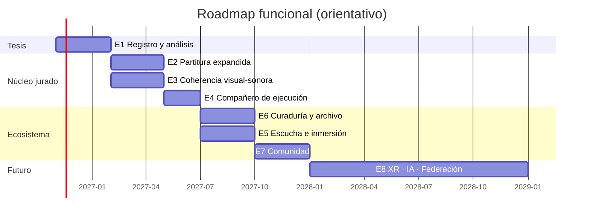

# Roadmap funcional: observaciones del jurado y desarrollo futuro

**La Casa de Salomón**: plan de mejoras funcionales del software, por etapas, sub-etapas y checklist editable.
Creado: 2026-11-01

Fuentes:
- Observaciones del examen de candidatura del 23 de febrero de 2026, en `03_Administrativo/Jurado/ObservacionesJurado/PLAN_COMPILADO_JURADO.md`.
- Proyección futura (VIII, Sánchez Escuer).
- Pendientes de [ROADMAP_DESARROLLO_FUTURO.md](ROADMAP_DESARROLLO_FUTURO.md).

Relación con los otros roadmaps:
- [ROADMAP_DESARROLLO_FUTURO.md](ROADMAP_DESARROLLO_FUTURO.md) registra la infraestructura técnica construida (motores, red, HRTF…).
- [ROADMAP_MEJORAS_2026.md](ROADMAP_MEJORAS_2026.md) cubre calidad, seguridad y mantenimiento.
- **Este documento** convierte las críticas del jurado en **funciones que la persona usuaria ve y usa**.

---

## Cómo usar este documento

- Marca `[x]` al terminar una tarea y añade la fecha y el archivo, como en el roadmap anterior: `✅ 2026-11-20 — src/lib/...`.
- `[~]` = en progreso.
- Cada tarea lleva su origen: **[GC]** García Castilla · **[SE]** Sánchez Escuer · **[GG]** Gracida · **[HS]** Hugo Solís · **[FUT]** desarrollo futuro.
- **Base existente** indica qué módulo ya cubre parte de la tarea, para extenderlo y no rehacerlo.
- **Hecho cuando** es el criterio de aceptación de cada sub-etapa.
- Regla de ritmo: **una etapa activa a la vez**. Se pasa a la siguiente cuando la actual cumple sus criterios.

---

## Resumen

| Etapa | Tema | Jurado | Prioridad | Tareas | Hechas |
| :--- | :--- | :---: | :---: | :---: | :---: |
| **E1** | Registro y análisis de sesiones | SE · GC · GG | 🔴 Crítica (alimenta la tesis) | 22 | 22 |
| **E2** | La partitura expandida dentro del software | SE | 🔴 Alta | 20 | 20 |
| **E3** | Coherencia visual-sonora | HS · GC | 🔴 Alta | 13 | 13 |
| **E4** | El sistema como compañero de ejecución | HS · SE | 🟠 Media-alta | 12 | 12 |
| **E5** | Escucha, síntesis e inmersión | SE · HS · GG | 🟠 Media | 14 | 0 |
| **E6** | Curaduría, archivo y reapropiación | SE | 🟠 Media | 15 | 0 |
| **E7** | Comunidad, interoperabilidad y evaluación colectiva | GC | 🟡 Media | 14 | 0 |
| **E8** | Proyección futura (XR, IA, federación, sostenibilidad) | SE · FUT | 🟢 Largo plazo | 16 | 0 |
| **TOTAL** | | | | **126** | **67** |

**Orden recomendado:** E1 → E2 → E3 → E4 → E6 → E5 → E7 → E8.
E1 va primero porque genera los datos que faltan en la tesis: la Etapa 3.1 (análisis musicológico) y la 3.2.2 (métricas reales de rendimiento) del plan del jurado siguen abiertas.

---

## E1 · Registro y análisis de sesiones 🔴

> **[SE]** Documentar resultados sonoros concretos: duraciones, organización rítmica, sistemas de alturas, tratamiento tímbrico, densidad, intervención algorítmica frente a humana, análisis comparativo.
> **[GC]** Los estudios de caso requieren un análisis de mayor profundidad.
> **[SE/GG]** Benchmarks reales: latencia en sesiones internacionales, FPS, CPU/GPU.

### E1.1 · Grabador de sesión

*Base existente:* `src/lib/score/topologicalScore.ts` (5.3) exporta una **instantánea**, no una línea de tiempo.

- [x] **E1.1.1** Registro de eventos con marca de tiempo: crear, mover, borrar, cambiar parámetro, entrar y salir de zona. Incluir autor (usuario, agente o tutor) y capa. **[SE]** ✅ 2026-11-02 — `src/lib/session/sessionRecorder.ts`, `src/lib/agents/SonicGardener.ts`
- [x] **E1.1.2** Grabación del audio maestro (MediaRecorder sobre el bus de salida) y descarga en WAV/OGG. **[SE]** ✅ 2026-11-02 — `src/lib/session/sessionRecorder.ts`
- [x] **E1.1.3** Grabación binaural opcional desde la posición de una persona oyente concreta. **[SE][GG]** ✅ 2026-11-02 — `src/lib/session/sessionRecorder.ts`
- [x] **E1.1.4** Formato de sesión `.casa.json` v2: instantánea inicial, eventos y metadatos (sala, participantes anónimos, nivel N1–N4, duración). Documentar el JSON Schema. **[SE]** ✅ 2026-11-02 — `src/lib/session/sessionRecorder.ts` (`CASA_SESSION_V2_JSON_SCHEMA`)
- [x] **E1.1.5** Consentimiento explícito antes de grabar y anonimización de participantes. **[GC]** ✅ 2026-11-02 — `src/lib/session/sessionRecorder.ts` (`anonymizeParticipantId`, `setConsentGranted`)

**Hecho cuando:** una sesión de 15 min con 3 participantes produce un `.casa.json` y un audio que se pueden reabrir.

### E1.2 · Reproductor temporal (replay)

*Base existente:* `src/lib/score/scoreInterpreter.ts` (5.5) recrea una instantánea estática.

- [x] **E1.2.1** Reproducir una sesión grabada en el tiempo, con play, pausa, velocidad y barra de desplazamiento. ✅ 2026-11-02 — `src/lib/session/sessionReplay.ts`, `src/components/ui/SessionResearchPanel.tsx`
- [x] **E1.2.2** Navegar en 3D libremente mientras se reproduce la sesión. ✅ 2026-11-02 — `src/lib/session/sessionReplay.ts`
- [x] **E1.2.3** Marcadores y anotaciones del investigador sobre la línea de tiempo, exportables. ✅ 2026-11-02 — `src/lib/session/sessionRecorder.ts`, `src/lib/session/sessionReplay.ts`

**Hecho cuando:** se puede volver a escuchar y anotar un caso de estudio sin el grupo original.

### E1.3 · Analítica musicológica automática

*Base existente:* `src/lib/pedagogy/sessionMetrics.ts` mide densidad por banda, objetos y tiempo.

- [x] **E1.3.1** Duración total, duración por fase y tiempo activo de cada participante. **[SE]** ✅ 2026-11-02 — `src/lib/session/musicologicalAnalysis.ts`
- [x] **E1.3.2** Sistema de alturas: histograma de frecuencias → clasificación tonal, modal, microtonal, espectral o indeterminada (proximidad a la escala temperada y a la serie armónica). **[SE]** ✅ 2026-11-02 — `src/lib/session/musicologicalAnalysis.ts`
- [x] **E1.3.3** Organización rítmica: intervalos de auto-disparo, periodicidad frente a irregularidad, densidad de eventos por minuto. **[SE]** ✅ 2026-11-02 — `src/lib/session/musicologicalAnalysis.ts`
- [x] **E1.3.4** Tratamiento tímbrico: distribución por tipo de síntesis y de efecto, centroide espectral a lo largo del tiempo. **[SE]** ✅ 2026-11-02 — `src/lib/session/musicologicalAnalysis.ts`
- [x] **E1.3.5** Densidad textural en el tiempo (curva), no solo como promedio. **[SE]** ✅ 2026-11-02 — `src/lib/session/musicologicalAnalysis.ts`
- [x] **E1.3.6** Proporción de intervención humana frente a algorítmica (Jardinero Sónico, auto-disparo y mapeos). **[SE][HS]** ✅ 2026-11-02 — `src/lib/session/musicologicalAnalysis.ts`
- [x] **E1.3.7** Exportar CSV/JSON listos para la tesis y comparar varias sesiones lado a lado (Moscú, Diáspora, China). **[SE][GC]** ✅ 2026-11-02 — `src/lib/session/musicologicalAnalysis.ts` (`THESIS_CASE_STUDY_BENCHMARKS`, `exportMusicologicalComparison`)

**Hecho cuando:** los tres casos de estudio tienen ficha musicológica comparativa → se cierra la Etapa 3.1 del plan del jurado.

### E1.4 · Telemetría técnica de sesión

*Base existente:* `LatencyMonitor`, `FPSDisplay`, `engineBenchmark.ts`.

- [x] **E1.4.1** Registro continuo de RTT por par (WebRTC y Firebase), FPS, carga del AudioContext, memoria y número de voces activas. **[GG][SE]** ✅ 2026-11-02 — `src/lib/session/sessionTelemetry.ts`, `src/lib/network/PeerNetwork.ts`
- [x] **E1.4.2** Etiqueta de región aproximada por participante (país), sin datos personales, para medir sesiones internacionales. **[SE]** ✅ 2026-11-02 — `src/lib/session/sessionRecorder.ts` (`inferAnonymousRegionCode`), `src/lib/session/sessionTelemetry.ts`
- [x] **E1.4.3** Informe técnico por sesión con percentiles p50/p95 de latencia y dispositivos usados. **[SE]** ✅ 2026-11-02 — `src/lib/session/sessionTelemetry.ts`
- [x] **E1.4.4** Comparación TCP (Firebase) frente a UDP (WebRTC) con datos reales de campo. **[GG]** ✅ 2026-11-02 — `src/lib/session/sessionTelemetry.ts` (`TransportComparisonReport`)

**Hecho cuando:** existe al menos una sesión internacional medida → se cierra la Etapa 3.2.2 del plan del jurado.

### E1.5 · Visualizaciones de sesión

*Base existente:* `src/lib/score/graphicScore.ts` (5.4).

- [x] **E1.5.1** Mapa de calor de la distribución espacial de objetos y recorridos. **[SE]** ✅ 2026-11-02 — `src/lib/session/sessionVisualizations.ts` (`generateSpatialHeatmapSvg`)
- [x] **E1.5.2** Diagrama topológico animado o por fases para cada caso de estudio. **[SE]** ✅ 2026-11-02 — `src/lib/session/sessionVisualizations.ts` (`generatePhaseTopologicalSvg`)
- [x] **E1.5.3** Partitura gráfica temporal (eje = tiempo) exportable en SVG para la tesis y artículos. ✅ 2026-11-02 — `src/lib/session/sessionVisualizations.ts` (`generateTemporalGraphicScoreSvg`)

---

## E2 · La partitura expandida dentro del software 🔴

> **[SE]** Describir el modelo operativo como partitura expandida o algoritmo compositivo: roles, turnos, capas, jerarquías, síncrono, asíncrono o híbrido, parámetros abiertos o delimitados.
> **[SE]** Niveles al estilo videojuego, sesiones de duración fija, fases, convocatorias y temporadas.

En la tesis esto ya está **redactado** (2026-06-05). Esta etapa lo **implementa** para que el protocolo exista en la plataforma.

### E2.1 · Roles y permisos

- [x] **E2.1.1** Roles por sala: moderación, composición, interpretación, escucha y curaduría. ✅ 2026-11-02 — `src/lib/score/expandedScoreProtocol.ts`
- [x] **E2.1.2** Matriz de permisos por rol (crear, mover, editar síntesis, efectos, grabar). ✅ 2026-11-02 — `src/lib/score/expandedScoreProtocol.ts` (`ROLE_PERMISSIONS`), `src/state/useWorldStore.ts`
- [x] **E2.1.3** La moderación asigna y cambia roles en vivo. Integrar con `TutorDashboard`. ✅ 2026-11-02 — `src/components/ui/TutorDashboard.tsx`, `src/components/ui/ExpandedScorePanel.tsx`
- [x] **E2.1.4** Indicador visual del rol de cada participante en la escena. ✅ 2026-11-02 — `src/components/world/ParticipantRoleIndicators3D.tsx`

### E2.2 · Capas, turnos y modos de colaboración

- [x] **E2.2.1** Capas compositivas (por ejemplo: fondo/textura, gesto/ritmo, espacio/móviles) asignables a participantes. ✅ 2026-11-02 — `src/lib/score/expandedScoreProtocol.ts` (`assignParticipantLayer`)
- [x] **E2.2.2** Propiedad de objetos: quien crea un objeto lo controla, con opción de cederlo. ✅ 2026-11-02 — `src/lib/score/expandedScoreProtocol.ts` (`registerObjectOwner`, `transferObjectOwnership`), `src/state/useWorldStore.ts`
- [x] **E2.2.3** Modo **síncrono** (todos a la vez), que es el actual. ✅ 2026-11-02 — `src/lib/score/expandedScoreProtocol.ts`
- [x] **E2.2.4** Modo **por turnos**: ronda con duración por turno y cola de participantes. ✅ 2026-11-02 — `src/lib/score/expandedScoreProtocol.ts` (`advanceTurn`, `turnRemainingSec`)
- [x] **E2.2.5** Modo **asíncrono**: cada persona deja una capa y la siguiente la escucha antes de intervenir (cadáver exquisito sonoro). ✅ 2026-11-02 — `src/lib/score/expandedScoreProtocol.ts` (`commitAsyncExquisiteCorpseLayer`, `markAsyncLayerListened`)
- [x] **E2.2.6** Parámetros abiertos o bloqueados por la moderación para cada sesión (grados de libertad explícitos). ✅ 2026-11-02 — `src/lib/score/expandedScoreProtocol.ts` (`ParameterFreedomLocks`), `src/state/useWorldStore.ts`

### E2.3 · Sesiones con forma temporal

- [x] **E2.3.1** Duraciones preestablecidas (10, 15, 30 min y libre) con cuenta regresiva visible. ✅ 2026-11-02 — `src/lib/score/expandedScoreProtocol.ts`, `src/components/ui/ExpandedScorePanel.tsx`
- [x] **E2.3.2** Fases dentro de una sesión (experimentación → consolidación → producción → presentación) con cambios automáticos de reglas. ✅ 2026-11-02 — `src/lib/score/expandedScoreProtocol.ts` (`PHASE_DESCRIPTIONS`, `startTimedSession`)
- [x] **E2.3.3** Plantillas de sesión ("partituras de juego") que guardan roles, capas, niveles y fases, y se pueden compartir. ✅ 2026-11-02 — `src/lib/score/expandedScoreProtocol.ts` (`BUILTIN_GAME_SCORE_TEMPLATES`, `exportCurrentGameScoreTemplate`)
- [x] **E2.3.4** Al terminar, la sesión se archiva sola con el grabador de E1. ✅ 2026-11-02 — `src/lib/score/expandedScoreProtocol.ts` (`stopTimedSession`)

### E2.4 · Niveles como recorrido

*Base existente:* `src/lib/pedagogy/parametricLevels.ts` (N1–N4).

- [x] **E2.4.1** Restricciones por nivel en tempo, registro, densidad máxima y duración, además de las herramientas actuales. ✅ 2026-11-02 — `src/lib/pedagogy/parametricLevels.ts` (`tempoRangeBpm`, `maxObjectsDensity`, `recommendedDurationMin`)
- [x] **E2.4.2** Retos por nivel, con un objetivo compositivo y un criterio de cumplimiento medido con E1.3. ✅ 2026-11-02 — `src/lib/pedagogy/parametricLevels.ts` (`evaluateLevelChallenge`)
- [x] **E2.4.3** Progreso por participante y desbloqueo del siguiente nivel. ✅ 2026-11-02 — `src/lib/pedagogy/parametricLevels.ts` (`unlockNextLevel`, `completedChallenges`)

### E2.5 · Modelos de participación

- [x] **E2.5.1** Tipos de sala: abierta, por invitación (enlace) y ensamble cerrado (dúo, trío, cuarteto). ✅ 2026-11-02 — `src/lib/score/expandedScoreProtocol.ts` (`ROOM_CAPACITY_BY_TYPE`)
- [x] **E2.5.2** Convocatorias y temporadas: calendario de sesiones con inscripción y cupo. ✅ 2026-11-02 — `src/lib/score/expandedScoreProtocol.ts` (`seasonCalls`, `toggleSeasonCallEnrollment`)
- [x] **E2.5.3** Micro-redes de afinidad: grupos persistentes con historial de sesiones. ✅ 2026-11-02 — `src/lib/score/expandedScoreProtocol.ts` (`affinityGroups`, `createAffinityGroup`)

**Hecho cuando:** una sesión de taller puede correr de principio a fin (roles → fases → grabación) sin intervención técnica.

---

## E3 · Coherencia visual-sonora 🔴

> **[HS]** Los objetos gráficos y su sonido parecen operar de manera independiente. La coherencia no tiene que ser mimética, pero debe responder a una **lógica reconocible** (estructural, gestual o simbólica).
> **[GC]** La plataforma se basa en la relación intrínseca entre sonido y fuente, así que no es acusmática.

*Base existente:* `MappingEngine.ts` + `transferCurves.ts` (5.1/5.2), `AudioReactiveAuras.tsx`, `InfluenceGuides.tsx`. Los mapeos existen, pero hay que **declararlos a mano**.

### E3.1 · Mapeos por defecto con lógica explícita

- [x] **E3.1.1** Definir para cada tipo de objeto una lógica base documentada. Ejemplos: tamaño → registro (más grande = más grave), altura en Y → brillo espectral, rotación → modulación, forma → familia tímbrica. ✅ 2026-11-02 — `src/lib/mapping/visualSonicCoherence.ts` (`OBJECT_TIMBRAL_LOGIC`)
- [x] **E3.1.2** Aplicar esos mapeos **automáticamente al crear** un objeto, con la opción de desactivarlos o editarlos. ✅ 2026-11-02 — `src/lib/mapping/visualSonicCoherence.ts` (`applyDefaultMappingsForNewObject`) y `src/state/useWorldStore.ts`
- [x] **E3.1.3** Tres presets de lógica seleccionables por sala: **estructural**, **gestual** y **simbólica**. ✅ 2026-11-02 — `src/lib/mapping/visualSonicCoherence.ts` (`VISUAL_SONIC_PRESETS`, `setRoomVisualSonicPreset`)

### E3.2 · El sonido se ve

- [x] **E3.2.1** Amplitud → emisión y escala pulsante en todos los objetos, no solo en las auras. ✅ 2026-11-02 — `src/components/world/SoundObjectsRenderer.tsx`
- [x] **E3.2.2** Espectro → deformación de la geometría por shader (los armónicos deforman la superficie). ✅ 2026-11-02 — `src/components/world/AudioReactiveAuras.tsx`
- [x] **E3.2.3** Envolvente (ataque y decaimiento) → animación visible del disparo. ✅ 2026-11-02 — `src/components/world/SoundObjectsRenderer.tsx` y `notifyObjectSoundTriggered`
- [x] **E3.2.4** Zonas de efecto con visual derivada del efecto (la reverberación difumina, el delay deja ecos visuales). ✅ 2026-11-02 — `src/components/world/AudioReactiveAuras.tsx` (`EffectZoneVisualSignature`)

### E3.3 · Lógica legible

- [x] **E3.3.1** Panel "¿por qué suena así?" que explica los mapeos activos del objeto seleccionado. ✅ 2026-11-02 — `src/components/ui/VisualSonicCoherencePanel.tsx` (`explainWhyObjectSoundsLikeThis`)
- [x] **E3.3.2** Leyenda de la sala con la lógica visual-sonora activa. ✅ 2026-11-02 — `src/components/ui/VisualSonicCoherencePanel.tsx` (`showRoomLegend`)

### E3.4 · Contrapunto y evaluación

- [x] **E3.4.1** Modo **acusmático experimental** que oculta las fuentes visuales, como contraste para discutir la observación de [GC]. ✅ 2026-11-02 — `src/lib/mapping/visualSonicCoherence.ts` (`acousmaticMode`) y `SoundObjectsRenderer.tsx`
- [x] **E3.4.2** Prueba perceptual en la plataforma: ¿la persona participante adivina qué objeto suena? Mide el reconocimiento de la lógica. ✅ 2026-11-02 — `src/lib/mapping/visualSonicCoherence.ts` (`startPerceptualTrial`, `submitPerceptualGuess`)
- [x] **E3.4.3** Recoger los resultados de E3.4.2 con E1 para la tesis o un artículo. ✅ 2026-11-02 — `src/lib/mapping/visualSonicCoherence.ts` (`exportPerceptualEvaluationReport` + `recordSessionEvent`)
- [x] **E3.4.4** Guardar en la partitura topológica (`.casa.json`) la lógica de mapeo usada en cada sesión. ✅ 2026-11-02 — `src/lib/score/topologicalScore.ts` (`visualSonicPreset`, `parameterMappings`)

**Hecho cuando:** en la prueba E3.4.2, la mayoría reconoce la relación objeto-sonido mejor que al azar.

---

## E4 · El sistema como compañero de ejecución 🟠

> **[HS]** La dimensión colectiva (improvisación en grupo, agencia distribuida, el sistema como compañero de ejecución) puede ser el eje vertebrador.

*Base existente:* `SonicGardener.ts`, `accompaniment.ts` y `TrajectoryPredictor.ts` (6.1, 6.3, 6.5).

### E4.1 · Un agente que escucha y responde

- [x] **E4.1.1** Perfiles de comportamiento del agente: imitar, contrastar, sostener, callar y provocar. ✅ 2026-11-02 — `src/lib/agents/SonicGardener.ts` (`AgentBehaviorProfile`, `AGENT_PROFILE_LABELS`)
- [x] **E4.1.2** Respuesta a gestos humanos, no solo a la densidad global (por ejemplo: alguien acelera y el agente responde). ✅ 2026-11-02 — `src/lib/agents/SonicGardener.ts` (`recentHumanGestureRatePerMin`, `gestureBoost`)
- [x] **E4.1.3** Memoria corta del agente: retoma un motivo que alguien tocó minutos antes. ✅ 2026-11-02 — `src/lib/agents/SonicGardener.ts` (`shortTermMotifMemory`, `actImitate`)
- [x] **E4.1.4** Usar `TrajectoryPredictor` para anticipar adónde va una persona y preparar material allí. ✅ 2026-11-02 — `src/lib/agents/SonicGardener.ts` (`feedParticipantPosition`, `actProvoke`)

### E4.2 · Transparencia y control

- [x] **E4.2.1** Visualizar las intenciones del agente ("voy a contrastar la banda grave"). ✅ 2026-11-02 — `src/components/ui/SonicGardenerToggle.tsx` (`currentIntention`)
- [x] **E4.2.2** Controles de agencia: cuánto interviene y en qué capas (relación con E2.2). ✅ 2026-11-02 — `src/components/ui/SonicGardenerToggle.tsx` (`interventionRate`, `allowedLayers`)
- [x] **E4.2.3** Registrar cada acción del agente con su autoría para la analítica de E1.3.6. ✅ 2026-11-02 — `src/lib/agents/SonicGardener.ts` (`withSessionAuthor('agent', ..., agent.id)`)

### E4.3 · Agencia distribuida

- [x] **E4.3.1** Varios agentes con personalidades distintas en la misma sala. ✅ 2026-11-02 — `src/lib/agents/SonicGardener.ts` (`DEFAULT_AGENTS`, `tickAll`)
- [x] **E4.3.2** Que un agente adopte las reglas de la partitura de E2 (turnos, fases). ✅ 2026-11-02 — `src/lib/agents/SonicGardener.ts` (`respectScoreRulesE2`)
- [x] **E4.3.3** Modo "ensamble mínimo": una persona con dos agentes, para practicar en solitario. ✅ 2026-11-02 — `src/lib/agents/SonicGardener.ts` (`enableMinimumEnsembleMode`)
- [x] **E4.3.4** Agente director: propone cambios de fase o de nivel según el estado de la sala. ✅ 2026-11-02 — `src/lib/agents/SonicGardener.ts` (`evaluateDirectorProposal`, `applyDirectorProposal`)
- [x] **E4.3.5** Sesiones comparativas con y sin agente, medidas con E1, como material de tesis o artículo. ✅ 2026-11-02 — `src/lib/agents/SonicGardener.ts` (`captureComparativeSessionSnapshot`, `exportComparativeAgencyReportJson`)

---

## E5 · Escucha, síntesis e inmersión 🟠

> **[SE]** ¿Qué escucha demanda esta arquitectura: inmersiva, fragmentaria, procesual? ¿El oyente es pasivo o activo?
> **[HS]** Tone.js oculta la síntesis: usar Web Audio API o Csound WASM.
> **[GG]** HRTF genérica frente a individualizada.

### E5.1 · Modo escucha

*Base existente:* modo visitante de galería (`residency.ts`).

- [ ] **E5.1.1** Rol de oyente en salas en vivo: navega y escucha sin editar, con presencia mínima visible.
- [ ] **E5.1.2** Escucha **activa**: la persona oyente elige su recorrido, y su posición cambia lo que oye.
- [ ] **E5.1.3** Rutas de escucha guiadas (cámara y posición predefinidas por la persona compositora).
- [ ] **E5.1.4** Escucha **procesual**: ver la línea de tiempo de la obra mientras se escucha (con E1.2).
- [ ] **E5.1.5** Retroalimentación ligera del público (reacciones) visible para quienes interpretan.

### E5.2 · Síntesis de bajo nivel al alcance de quien compone

*Base existente:* motor nativo (`src/lib/audio/native/`, solo cubre AMSynth), `CsoundEngine.ts`, `CodeEditor.tsx`.

- [ ] **E5.2.1** Paridad del motor nativo con todos los tipos de síntesis y decisión del motor por defecto.
- [ ] **E5.2.2** Tipo de objeto **Csound**: instrumento definido en código y editable en vivo.
- [ ] **E5.2.3** Biblioteca de instrumentos Csound comunitarios, que se pueden compartir y versionar.
- [ ] **E5.2.4** Vista "bajo el capó": grafo de nodos Web Audio del objeto seleccionado (responde a la observación de abstracción de [HS]).

### E5.3 · Inmersión personalizada

*Base existente:* SOFA, `SofaSpatializer`, `HrtfProfileManager`, `AcousticCalibrator`, `headTracking.ts`.

- [ ] **E5.3.1** Asistente para elegir HRTF mediante una prueba perceptual corta (elegir el perfil que localiza mejor).
- [ ] **E5.3.2** Registrar en la telemetría si cada participante usó HRTF genérica o personalizada.
- [ ] **E5.3.3** Prueba de localización (delante/detrás, elevación) para comparar perfiles. Los datos van a la discusión de [GG].
- [ ] **E5.3.4** Exportar Ambisonics (B-format) para salas con sistemas multicanal.
- [ ] **E5.3.5** Guía de uso con auriculares frente a altavoces, con detección y aviso.

---

## E6 · Curaduría, archivo y reapropiación 🟠

> **[SE]** Curadores que seleccionan fragmentos para conciertos, reutilización por otros compositores, archivos sonoros reconfigurables: la plataforma como **generadora de materia prima compositiva** (segunda capa autoral).

*Base existente:* galerías (`/galeria`, `GalleryPublisher.tsx`, 8.5).

### E6.1 · Fragmentos

- [ ] **E6.1.1** Seleccionar fragmentos (entrada y salida) dentro de una sesión grabada en E1.
- [ ] **E6.1.2** Metadatos del fragmento: autores, sala, fecha, nivel, etiquetas y descripción.
- [ ] **E6.1.3** Licencia por fragmento (Creative Commons a elegir) acordada por las personas participantes.

### E6.2 · Archivo público

- [ ] **E6.2.1** Archivo navegable de sesiones, fragmentos y esculturas con búsqueda y filtros.
- [ ] **E6.2.2** Página de cada obra con audio, partitura gráfica, ficha musicológica (E1.3) y créditos.
- [ ] **E6.2.3** Colecciones curadas, donde una persona curadora agrupa fragmentos con un texto.

### E6.3 · Reapropiación con atribución

- [ ] **E6.3.1** Bifurcar (fork) un mundo o fragmento para crear una obra derivada.
- [ ] **E6.3.2** Cadena autoral visible: de qué obra deriva, con quiénes y qué cambió.
- [ ] **E6.3.3** Exportar stems o multipista por objeto o capa, para trabajar en un DAW.
- [ ] **E6.3.4** Exportar material como samples para la carga comunitaria (2.7).

### E6.4 · Modo concierto

- [ ] **E6.4.1** Lista de reproducción de fragmentos para una presentación pública.
- [ ] **E6.4.2** Salida multicanal o Ambisonics para sala física (con E5.3.4).
- [ ] **E6.4.3** Proyección: vista de cámara para pantalla grande sin interfaz.
- [ ] **E6.4.4** Concierto híbrido: público en sala y participantes remotos en la misma sesión.
- [ ] **E6.4.5** Programa de mano generado (créditos, notas y partitura gráfica).

---

## E7 · Comunidad, interoperabilidad y evaluación colectiva 🟡

> **[GC]** Hablar de **evaluación colectiva** en vez de "validación".
> **[GC]** Dialogar con Hydra (Olivia Jack) y TidalCycles (Alex McLean), plataformas comunitarias sin infraestructura comercial.
> **[GC]** El uso de herramientas abiertas no implica soberanía por sí solo: hay que profundizar en sus alcances reales.

### E7.1 · Evaluación colectiva integrada

- [ ] **E7.1.1** Cuestionario breve al cerrar la sesión (experiencia, escucha, colaboración, dificultad).
- [ ] **E7.1.2** Ronda de comentarios entre participantes, ligada a marcadores de la grabación.
- [ ] **E7.1.3** Resultados agregados por sesión y por taller, exportables (con E1.3.7).

### E7.2 · Interoperabilidad con la comunidad de live coding

- [ ] **E7.2.1** Entrada y salida MIDI (Web MIDI): controladores físicos manipulan objetos y la sala envía notas.
- [ ] **E7.2.2** Puente OSC (vía servidor local) con SuperCollider, Pure Data, Max y TidalCycles.
- [ ] **E7.2.3** Patrones estilo Strudel/Tidal como fuente de disparo de objetos.
- [ ] **E7.2.4** Capa visual Hydra opcional, alimentada por el audio de la sala.
- [ ] **E7.2.5** Contactar a esos proyectos para colaborar (una sesión conjunta o un taller) y documentarlo.

### E7.3 · Soberanía tecnológica en la práctica

*Base existente:* Docker, almacenamiento autohospedado, modo LAN (7.1, 7.2, 7.4).

- [ ] **E7.3.1** Instalación de un nodo comunitario en un comando, con guía para personas no técnicas.
- [ ] **E7.3.2** Exportar e importar todo lo de una comunidad (mundos, sesiones, fragmentos) sin depender de Firebase.
- [ ] **E7.3.3** Funcionamiento completo sin internet en LAN (aula sin conexión), probado en campo.
- [ ] **E7.3.4** Documentar los alcances y límites reales: qué depende aún de terceros (Google Auth, CDN, STUN), y planes para cada caso.
- [ ] **E7.3.5** Internacionalización de las funciones nuevas en los 7 idiomas.
- [ ] **E7.3.6** Programar sesiones internacionales con husos horarios visibles.

---

## E8 · Proyección futura 🟢

> **[SE]** Escenarios de evolución tecnológica, expansión internacional, realidad extendida, IA, sostenibilidad económica, aplicaciones pedagógicas.

### E8.1 · Realidad extendida

*Base existente:* WebXR (3.3), `VRToggle`.

- [ ] **E8.1.1** Manipulación de objetos con manos o controladores en VR, con paridad respecto al escritorio.
- [ ] **E8.1.2** Anclas espaciales en passthrough (pendiente 3.4): esculturas sonoras en el cuarto físico.
- [ ] **E8.1.3** Sesiones mixtas: personas en VR, escritorio y móvil en la misma sala.
- [ ] **E8.1.4** Instalación site-specific: un mundo anclado a un espacio físico de exposición.

### E8.2 · Inteligencia artificial

- [ ] **E8.2.1** Modelos en el navegador con ONNX o TensorFlow.js (pendiente 6.2) para el agente de E4.
- [ ] **E8.2.2** Timbre transfer en tiempo real con RAVE (pendiente 6.4) como efecto o tipo de objeto.
- [ ] **E8.2.3** Agente entrenado con las sesiones archivadas (E6), con consentimiento y licencias claras.
- [ ] **E8.2.4** Análisis automático de sesiones con IA, como complemento de E1.3 y no como sustituto.

### E8.3 · Federación y red

- [ ] **E8.3.1** Protocolo de federación entre nodos (pendiente 7.3, ActivityPub o P2P).
- [ ] **E8.3.2** Sesiones entre nodos de distintas comunidades.
- [ ] **E8.3.3** Archivo distribuido de obras entre nodos.

### E8.4 · Sostenibilidad y pedagogía

*Base existente:* `supportConfig.ts` (8.6), `curriculum.ts` y `CurriculumGuide` (8.3).

- [ ] **E8.4.1** Paquete para escuelas de música: plan de clases, niveles N1–N4 y E2 listos para usar.
- [ ] **E8.4.2** Programa de residencias artísticas con convocatoria anual (E2.5.2 + galerías).
- [ ] **E8.4.3** Modelo de sostenibilidad documentado: donaciones, talleres pagados, convenios institucionales.
- [ ] **E8.4.4** Métricas de impacto (comunidades, sesiones, obras) para solicitar fondos.
- [ ] **E8.4.5** Alianzas internacionales con 2 o 3 nodos en otros países como piloto de expansión.

---

## Trazabilidad: observación del jurado → etapa

| Observación | Sinodal | Etapas |
| :--- | :---: | :--- |
| Resultados sonoros concretos y análisis musicológico | SE | E1.3, E1.5 |
| Estudios de caso con más profundidad | GC | E1.1–E1.3, E7.1 |
| Métricas reales de latencia y rendimiento | SE · GG | E1.4 |
| Protocolo como partitura expandida (roles, turnos, capas) | SE | E2.1, E2.2 |
| Modelo de participación, temporadas y sesiones de duración fija | SE | E2.3, E2.5 |
| Niveles al estilo videojuego con restricciones progresivas | SE | E2.4 |
| Correlación visual-sonora con lógica reconocible | HS | E3 |
| No es acusmática: relación sonido-fuente | GC | E3.4.1 |
| Dimensión colectiva y sistema como compañero | HS | E4 |
| Modelo de escucha y recepción | SE | E5.1 |
| Abstracción de Tone.js → Web Audio / Csound | HS | E5.2 |
| HRTF genérica frente a individualizada | GG | E5.3 |
| Curaduría, reapropiación y segunda capa autoral | SE | E6 |
| Evaluación colectiva en vez de validación | GC | E7.1 |
| Diálogo con Hydra y TidalCycles | GC | E7.2 |
| Soberanía tecnológica real | GC | E7.3 |
| Proyección: XR, IA, sostenibilidad, pedagogía, internacional | SE | E8 |
| Relación con la tradición instrumental y la pedagogía | SE | E4.3.3, E8.4.1 |

---

## Bitácora

- 2026-11-01: Roadmap funcional creado a partir del plan compilado del jurado y de los pendientes del roadmap técnico.
- 2026-11-02: **Etapa E1 completada (22/22 tareas)**: grabador `.casa.json` v2 con JSON Schema, consentimiento explícito y anonimización; grabación de bus maestro WAV/OGG y binaural; reproductor temporal con marcadores de investigación; analítica musicológica automática y fichas comparativas de los tres casos de estudio (Moscú, Diáspora, China); telemetría continua con comparación TCP (Firebase) vs UDP (WebRTC); y visualizaciones SVG (mapa de calor espacial, diagrama topológico por fases y partitura gráfica temporal).
- 2026-11-02: **Etapa E2 completada (20/20 tareas)**: protocolo de partitura expandida con 5 roles y matriz de permisos, asignación en vivo desde `TutorDashboard`, balizas 3D de rol/capa en la escena, propiedad y cesión de objetos, modos síncrono, por turnos y cadáver exquisito sonoro asíncrono, bloqueo de parámetros, temporizador con 4 fases y auto-archivado en E1, retos compositivos por nivel N1–N4 evaluados con E1.3, plantillas compartibles ("partituras de juego"), tipos de sala, temporadas y micro-redes de afinidad.
- 2026-11-02: **Etapa E3 completada (13/13 tareas)**: documentación explícita forma geométrica → familia tímbrica (`OBJECT_TIMBRAL_LOGIC`), aplicación automática de mapeos al crear objetos, tres presets de lógica por sala (`structural`, `gestural`, `symbolic`), animación visual de amplitud y envolvente ataque/decaimiento en todos los objetos, firmas visuales derivadas del efecto acústico en `EffectZone`, inspector en vivo "¿Por qué suena así?", leyenda flotante de sala, modo acusmático experimental, prueba perceptual interactiva con tasa de acierto vs. azar `1/N` e integración en `.casa.json`.
- 2026-11-02: **Etapa E4 completada (12/12 tareas)**: 5 perfiles de comportamiento (`imitate`, `contrast`, `sustain`, `silence`, `provoke`), respuesta a la aceleración gestual humana, memoria corta de motivos humanos (1–5 min), anticipación espacial con `TrajectoryPredictor`, visualización en vivo de intenciones del agente, controles de nivel de agencia y filtro de capas E2.2, autoría por instancia de agente en E1.3.6, soporte multi-agente con personalidades distintas, adopción de turnos y fases de E2, modo "Ensamble Mínimo" (1 humano + 2 agentes), Agente Director de fases/niveles y estudio comparativo exportable Con Agente vs. Sin Agente.
